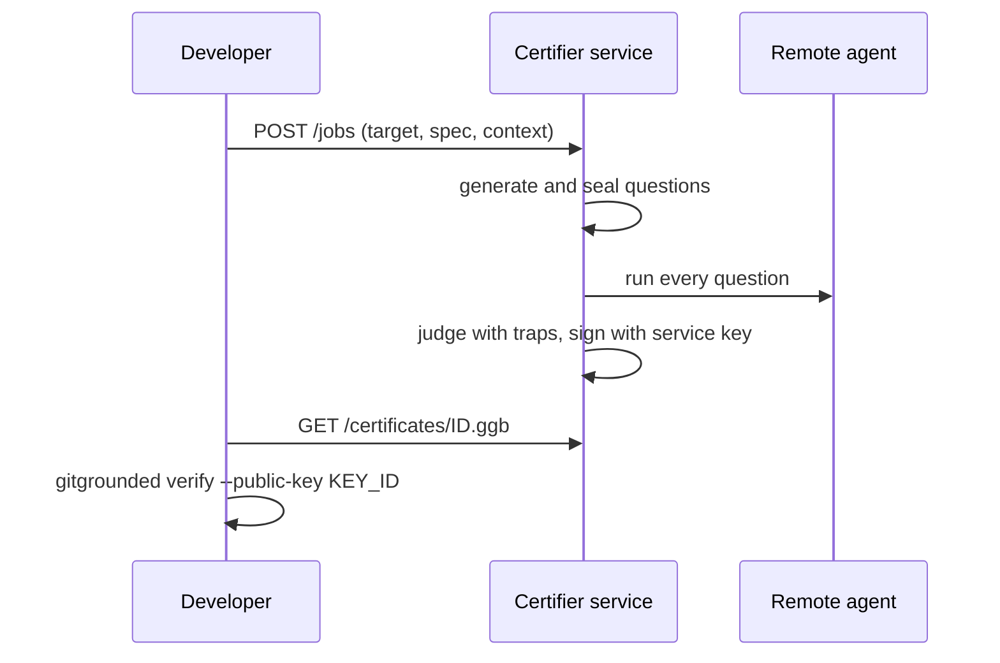

A self signed certificate proves a result was not edited. It does not prove the developer did not choose the setup. An **independent certifier** removes that doubt: the developer only submits a target URL and a spec. Question generation, execution, judging and signing all happen on a service the developer does not control.



## Run a certifier

```bash
pip install "gitgrounded[sign,pdf]"
GITGROUNDED_CERTIFIER_TOKENS=secret gitgrounded certifier serve --public-url https://certify.example.com
gitgrounded certifier pubkey
```

`GITGROUNDED_CERTIFIER_TOKENS` is a comma separated list of API tokens the service accepts. The service needs its own provider keys for the generator, validator and judge, set exactly as in [Providers](/docs/configuration/providers).

| Flag | Default | Meaning |
|---|---|---|
| `--host` | `127.0.0.1` | bind address |
| `--port` | `8765` | port |
| `--home` | `.gitgrounded-certifier` | jobs, certificates and the service key |
| `--key` | `HOME/certifier_ed25519.pem` | Ed25519 private key |
| `--name` | `gitgrounded-certifier` | name recorded in certificates |
| `--public-url` | none | public URL recorded in certificates |
| `--max-cases` | `200` | upper bound on questions per job |
| `--allow-private` | off | allow http and private network targets, for testing only |

<Warning>
Put the service behind TLS. By default it refuses plain http targets and connections to private, loopback, link local and carrier grade NAT addresses, never follows redirects, and rate limits each token to 20 jobs per hour.
</Warning>

## Request a certificate

Declare the remote target in `gitgrounded.yml` (an `http`, `a2a`, `adk` or `mcp` over HTTP target), then:

```bash
GITGROUNDED_CERTIFIER_TOKEN=secret gitgrounded certify-remote --service https://certify.example.com --target my_a2a --spec spec.txt --context policy.md
```

The client pins the service key, submits the job, waits, downloads `ID.ggb` (and `ID.pdf` when available) and verifies it. The exit code is 0 only when the bundle verifies as `VERIFIED_INDEPENDENT` and the target was certified.

| Flag | Default | Meaning |
|---|---|---|
| `--service` | required | certifier URL |
| `--target` | required | remote target name from `gitgrounded.yml` |
| `--spec` | none | system prompt or task description; repeat |
| `--context` | none | policy or knowledge files; repeat |
| `--budget-cases` | `40` | number of questions |
| `--name` | project name | name on the certificate |
| `--token` | `GITGROUNDED_CERTIFIER_TOKEN` | API token |
| `--expect-key` | service key | pin the certifier key id or base64 public key |
| `--timeout` | `3600` | seconds to wait for the job |
| `--out` | `ID.ggb` | certificate path |

## Verify someone else's certificate

```bash
gitgrounded verify cert.ggb --public-key KEY_ID
```

Get `KEY_ID` from the certifier operator or from `GET /pubkey` on the service. A bundle signed by that key verifies as `VERIFIED_INDEPENDENT`.

## HTTP API

| Method | Path | Auth | Returns |
|---|---|---|---|
| `GET` | `/health` | none | service name and version |
| `GET` | `/pubkey` | none | name, key id and public key |
| `POST` | `/jobs` | `Bearer` token | `202` with the queued job |
| `GET` | `/jobs/ID` | `Bearer` token | job status, reasons and certificate id |
| `GET` | `/certificates/ID` | none | the `.ggb` bundle |
| `GET` | `/certificates/ID.pdf` | none | the certificate PDF |
| `GET` | `/certificates/ID.html` | none | the certificate page |

Request bodies are capped at 2 MB.
