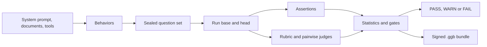

GitGrounded tests an LLM app before and after a change to a prompt, a model, a tool or an agent, and tells you with statistics whether the change made things better or worse. It writes the test suite for you from your own system prompt and policy documents, and it packages every result as a signed evidence bundle that anyone can verify.

<CardGroup cols={3}>
  <Card title="Builds your benchmark" icon="wand-magic-sparkles" href="/docs/coverage">
    Reads your system prompt, documents and MCP tool schemas, extracts every behavior, and generates a diverse suite proven strong with mutation testing.
  </Card>
  <Card title="Explains every change" icon="code-compare" href="/docs/regression">
    Runs every case on both versions of a git change, checks them with assertions and LLM judges, and reports confidence intervals and significance tests.
  </Card>
  <Card title="Produces evidence" icon="file-shield" href="/docs/evidence">
    Signed, hash chained `.ggb` bundles. Change one byte and verification fails. In CI the signature is bound to your workflow identity.
  </Card>
</CardGroup>

## Pick your path

<CardGroup cols={2}>
  <Card title="Five minute quickstart" icon="rocket" href="/docs/quickstart">
    Run the bundled demo offline, no API keys needed.
  </Card>
  <Card title="Compare prompts and models" icon="scale-balanced" href="/docs/compare">
    Two prompts, any number of models, one locked question set, one certificate.
  </Card>
  <Card title="Benchmark frameworks and agents" icon="trophy" href="/docs/frameworks">
    LangGraph, Strands, CrewAI, OpenAI Agents SDK, A2A, ADK, MCP and HTTP on one leaderboard.
  </Card>
  <Card title="Gate pull requests" icon="github" href="/docs/ci/github">
    The GitHub Action signs, attests and comments on every pull request.
  </Card>
</CardGroup>

## How it fits together

## What it supports

| Area | Supported |
|---|---|
| Providers | OpenAI, Claude, Groq, DeepSeek, Ollama, any OpenAI compatible host, and a deterministic offline provider |
| Targets | Python functions, Python agent frameworks, HTTP APIs, prompts on any provider, MCP servers, A2A agents, Google ADK agents |
| Frameworks | LangGraph, LangChain, Strands, CrewAI, OpenAI Agents SDK, Pydantic AI, LlamaIndex, AutoGen, smolagents, Haystack, DSPy and any object with `invoke`, `run` or `chat` |
| Reports | Terminal, self contained HTML, Markdown for pull requests, JUnit XML, JSON, certificate PDF |
| Signing | Sigstore in GitHub Actions, Ed25519 locally, or an independent certifier service |
| CI | GitHub Action, GitLab CI, pre commit hooks, Docker image |

<Note>
Every LLM call can run on a deterministic offline provider with `GITGROUNDED_OFFLINE=1`. Offline runs prove the plumbing works; they are never certified and the verifier flags them.
</Note>
